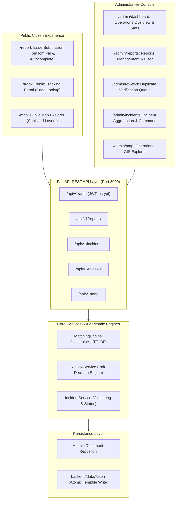
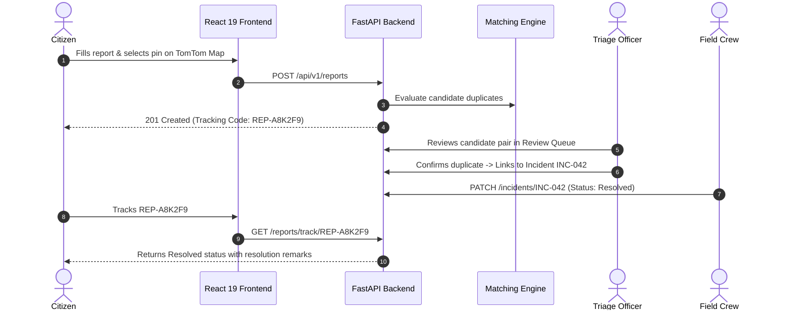
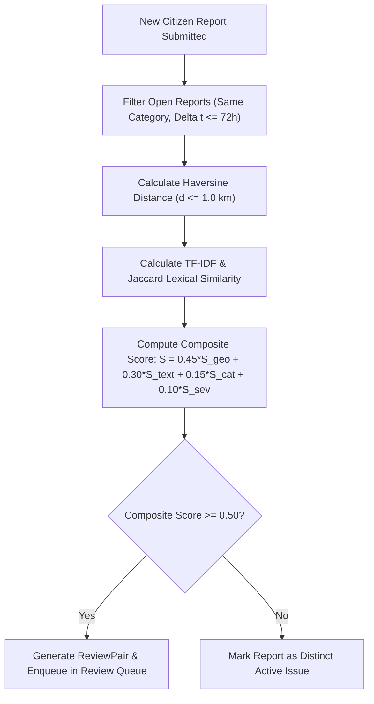

# RESQINTEL — COMPREHENSIVE DEVELOPER TECHNICAL GUIDE & ARCHITECTURE MANUAL

---

## 1. START HERE — UNDERSTANDING RESQINTEL

### 1.1 What is ResQIntel?
**ResQIntel** is an enterprise-grade civic issue reporting, automated incident aggregation, and municipal resolution monitoring platform. It is engineered specifically for modern urban environments (exemplified by the Kolkata metropolitan area) where multiple public agencies—such as municipal corporations (KMC), electrical utilities (CESC), metropolitan development boards (KMDA), and emergency services—must coordinate to resolve public infrastructure failures.

### 1.2 Why Was It Built?
In typical metropolitan cities, civic complaints are submitted through disparate channels: phone helplines, generic grievance forms, or social media mentions. This causes three critical failure modes:
1. **Redundant Duplicate Ingestion:** A single ruptured water pipe or fallen electrical wire triggers 20–50 calls. Each call generates a disconnected ticket, overwhelming dispatch teams.
2. **Geospatial Ambiguity:** Citizens provide vague landmarks (*"near the corner tea stall"*) rather than coordinates, leading to lost time for field crews.
3. **The Civic "Black Hole":** Citizens receive no feedback once a complaint is filed, destroying trust and inciting repeated angry inquiries.

ResQIntel solves this by unifying public reporting, algorithmic duplicate clustering, side-by-side administrative verification, and interactive TomTom geospatial mapping.

### 1.3 Core Philosophy
- **Zero-Barrier Public Ingestion:** Citizens should be able to report defects in under 60 seconds without account creation.
- **Human-in-the-Loop Intelligence:** Machine algorithms calculate spatial and lexical duplicate probabilities, but human triage officers retain ultimate verification and merge authority.
- **Radical Transparency:** Every report yields an unguessable public tracking code (e.g., `REP-A8K2F9`) providing five-stage live progression.
- **Architectural Portability:** A clean, decoupled architecture combining FastAPI (Python 3.11) and React 19 + Tailwind CSS v4.

### 1.4 Who Uses It and Why?
- **Citizens:** File geolocated reports with photos and track progress.
- **Triage Officers:** Review automated duplicate candidate pairs in a side-by-side workspace and link related reports.
- **Dispatchers & Field Supervisors:** Manage consolidated incidents, assign crews, and update statuses.
- **System Administrators:** Manage accounts, monitor system health, and inspect audit logs.

### 1.5 How It Differs From Generic Issue Trackers
Unlike generic bug trackers (e.g., Jira, Bugzilla), ResQIntel is fundamentally **spatial and civic**. It integrates:
- TomTom raster map layers with night/day themes.
- Street-level camera flight (`flyTo` zoom 16) with pulsing selection beacons.
- Bidirectional Haversine and TF-IDF duplicate scoring.
- Public privacy shielding (protecting citizen PII).

---

## 2. THE COMPLETE APPLICATION AT A GLANCE

### 2.1 High-Level Architecture Diagram


### 2.2 Tech Stack Table

| Layer | Component | Version | Rationale |
| :--- | :--- | :--- | :--- |
| **Frontend Framework** | React | 19.x | Ultra-responsive UI, lightweight virtual DOM, modern hooks. |
| **Bundler & Tooling** | Vite | 6.x | Instant HMR, fast production bundling. |
| **CSS Framework** | Tailwind CSS | 4.x | Zero-runtime CSS variables, dynamic breakpoint utilities. |
| **Icons** | Lucide React | Latest | Clean, consistent SVG iconography. |
| **Map Rendering** | Leaflet & React-Leaflet | 1.9.x / 4.2.x | High-performance interactive DOM raster map rendering. |
| **Geospatial APIs** | TomTom Web APIs | v2 | Map Display raster tiles, Places Autocomplete, Geocoding. |
| **Backend Framework** | FastAPI | 0.115.x | High-throughput asynchronous Python ASGI web framework. |
| **Data Validation** | Pydantic | 2.x | Strict schema validation, automatic OpenAPI documentation. |
| **Authentication** | python-jose / passlib | 3.3.x / 1.7.x | JWT Bearer token generation and bcrypt password hashing. |
| **Persistence** | Atomic Repository | Custom | Zero-overhead file-based document store with atomic writes. |

### 2.3 Port Assignments and Default URLs
- **Frontend Development Server:** `http://localhost:5173`
- **Backend API Server:** `http://localhost:8000`
- **Interactive OpenAPI Documentation:** `http://localhost:8000/docs`
- **Alternative ReDoc Documentation:** `http://localhost:8000/redoc`

---

## 3. REPOSITORY NAVIGATION — WHERE EVERYTHING LIVES

### 3.1 Quick Lookup Directory

| If you need to find... | Look in this path |
| :--- | :--- |
| **Database records (JSON)** | `backend/data/reports.json`, `incidents.json`, `reviews.json`, `users.json` |
| **FastAPI Route endpoints** | `backend/app/api/routes/` (`reports.py`, `incidents.py`, `reviews.py`, `auth.py`, `map.py`) |
| **JWT Security & Password Hashing** | `backend/app/core/security.py`, `backend/app/core/config.py` |
| **TomTom Map Frontend Components** | `frontend/src/components/TomTomMap.jsx`, `LocationPickerMap.jsx`, `TomTomMapNotice.jsx` |
| **TomTom API Client Service** | `frontend/src/services/tomtomService.js` |
| **Admin Layout, Sidebar & Topbar** | `frontend/src/layouts/AdminLayout.jsx`, `components/AdminSidebar.jsx`, `components/AdminTopbar.jsx` |
| **Global CSS & Scrollbars** | `frontend/src/style.css`, `frontend/src/index.css` |
| **Automated Verification Test Suite** | `backend/test_civic_platform.py` |
| **Academic Report & Documentation** | `PROJECT_REPORT.md`, `PROJECT_REPORT.docx`, `README.md`, `docs/screenshots/README.md` |

---

## 4. FRONTEND — HOW THE APPLICATION WORKS

### 4.1 Component Hierarchy
```
App.jsx (React Router Provider)
├── PublicLayout
│   ├── PublicNavbar
│   ├── [Outlet]
│   │   ├── LandingPage
│   │   ├── PublicReportPage (LocationPickerMap)
│   │   ├── PublicTrackingPage
│   │   ├── PublicMapPage (TomTomMap)
│   │   └── LoginPage
│   └── PublicFooter
└── AdminLayout (Sidebar + Topbar + Content Container)
    ├── AdminSidebar (Responsive Drawer & Navigation Links)
    ├── AdminTopbar (Breadcrumbs, Hamburger, User Dropdown)
    └── [Outlet]
        ├── DashboardPage (KPI StatCards, High-Priority Triage)
        ├── ReportsManagementPage (Filters, Search, Bulk Actions)
        ├── AdminReportDetailPage (TomTom Location Context)
        ├── IncidentManagementPage (Cluster Grouping)
        ├── IncidentDetailsPage (Command Lifecycle Stepper)
        ├── ReviewCentrePage (Side-by-Side Duplicate Queue)
        └── MapExplorerPage (GIS Operational Layer)
```

### 4.2 Map Integration Details
- **`TomTomMap.jsx`**: Renders raster tiles using `https://api.tomtom.com/map/1/tile/{style}/{zoom}/{x}/{y}.png`.
  - Dark Mode: `style = basic/night`.
  - Light Mode: `style = basic/main`.
  - **Camera Flight (`MapController`):** When `focusCoords` or `selectedId` changes, triggers `map.flyTo([lat, lng], 16, { duration: 1.1 })`.
  - **Beacon Pin (`createTomTomCivicPin`):** Dynamically builds an animated SVG pin with a pulsating outer beacon ring (`animate-ping`).
  - **Dynamic Invalidation (`ResizeObserver`):** Observes container resizing (e.g. sidebar collapse) and calls `map.invalidateSize()`.
- **`LocationPickerMap.jsx`**: Enables interactive pin dragging, click-to-pin, search autocomplete with debounced input (350ms), and automatic reverse geocoding via `tomtomService.js`.

---

## 5. BACKEND — HOW REQUESTS ARE PROCESSED

### 5.1 Request Lifecycle
```
[HTTP Client Request]
       │
       ▼
[Uvicorn ASGI Server]
       │
       ▼
[FastAPI Middleware Pipeline] (CORS, Request Timing, Error Catching)
       │
       ▼
[APIRouter & Route Dependency Injection] (OAuth2 Bearer Token Extraction & RBAC)
       │
       ▼
[Service Layer Logic] (e.g. MatchingEngine, ReviewService, IncidentService)
       │
       ▼
[Atomic Repository Layer] (backend/app/repositories/repository.py)
       │
       ▼
[Atomic File Write via os.replace] (Zero corruption guarantee)
       │
       ▼
[JSON Response Serialized via Pydantic]
```

### 5.2 Dependency Injection & Security
Every protected route depends on `get_current_user` in `backend/app/api/deps.py`:
```python
async def get_current_user(
    token: str = Depends(oauth2_scheme),
    repo: Repository = Depends(get_repository)
) -> User:
    payload = decode_access_token(token)
    user = repo.get_user(payload.get("sub"))
    if not user:
        raise HTTPException(status_code=401, detail="User not found")
    return user
```

---

## 6. DATABASE — HOW DATA IS STORED

### 6.1 Atomic File-Based Repository Pattern
Data entities are persisted as JSON arrays in `backend/data/`:
- `reports.json`
- `incidents.json`
- `reviews.json`
- `users.json`
- `audit_logs.json`

To guarantee atomic write safety without database corruptions during crashes or power loss, `backend/app/repositories/repository.py` writes to a temporary file in the same directory before performing an atomic filesystem replace:
```python
def _save_data(self, file_path: str, data: list):
    dir_name = os.path.dirname(file_path)
    with tempfile.NamedTemporaryFile("w", dir=dir_name, delete=False, encoding="utf-8") as tf:
        json.dump(data, tf, indent=2, ensure_ascii=False)
        temp_name = tf.name
    os.replace(temp_name, file_path)
```

---

## 7. COMPLETE FEATURE-BY-FEATURE IMPLEMENTATION GUIDE

### Feature 1: Public Issue Reporting
- **File Locations:** `frontend/src/pages/public/PublicReportPage.jsx`, `backend/app/api/routes/reports.py`
- **Workflow:** Citizen enters issue title, category, description, photo; clicks map or enters address; TomTom geocodes coordinates; report is submitted to `POST /api/v1/reports`.
- **Output:** Returns unique tracking code (e.g., `REP-A8K2F9`). Automated matching engine enqueues duplicate candidates in the background.

### Feature 2: Issue Tracking by Code
- **File Locations:** `frontend/src/pages/public/PublicTrackingPage.jsx`, `backend/app/api/routes/reports.py` (`GET /api/v1/reports/track/{code}`)
- **Workflow:** Citizen enters tracking code; backend returns report status, timestamps, and municipal comments; reporter's phone number and email are shielded.

### Feature 3: Public Map Explorer
- **File Locations:** `frontend/src/pages/public/PublicMapPage.jsx`, `backend/app/api/routes/map.py` (`GET /api/v1/map/public`)
- **Workflow:** Renders active public issues on TomTom map; clicking an issue card flies the camera to coordinates (`zoom 16`) and displays popup details.

### Feature 4: Admin Dashboard
- **File Locations:** `frontend/src/pages/DashboardPage.jsx`, `backend/app/api/routes/dashboard.py`
- **Workflow:** Surfaces 6 responsive KPI metric cards, high-priority triage incident list, and recent audit activity.

### Feature 5: Reports Management
- **File Locations:** `frontend/src/pages/ReportsManagementPage.jsx`, `backend/app/api/routes/reports.py`
- **Workflow:** Full-text search, multi-category and status filters, sorting, borough filtering, and direct navigation to report details.

### Feature 6: Report Detail & Investigation
- **File Locations:** `frontend/src/pages/admin/AdminReportDetailPage.jsx`
- **Workflow:** View full report evidence, embedded TomTom location preview, citizen contact info, status change buttons, and incident link selector.

### Feature 7: Review Queue (Duplicate Detection & Comparison)
- **File Locations:** `frontend/src/pages/ReviewCentrePage.jsx`, `backend/app/services/review_service.py`
- **Workflow:** Displays side-by-side comparison of candidate duplicate reports with spatial distance in meters, text similarity score, and one-click "Confirm Duplicate", "Reject Candidate", and "Create Incident" buttons.

### Feature 8: Incident Management
- **File Locations:** `frontend/src/pages/IncidentManagementPage.jsx`, `backend/app/api/routes/incidents.py`
- **Workflow:** Displays aggregated incidents with child report counts, assigned municipal departments, and severity badges.

### Feature 9: Incident Command / Detail
- **File Locations:** `frontend/src/pages/IncidentDetailsPage.jsx`
- **Workflow:** Five-stage lifecycle progression stepper (`Investigating` $\rightarrow$ `Action Required` $\rightarrow$ `In Progress` $\rightarrow$ `Monitoring` $\rightarrow$ `Resolved`), resolution remarks, and list of linked child reports.

### Feature 10: Operational Map Explorer
- **File Locations:** `frontend/src/pages/MapExplorerPage.jsx`
- **Workflow:** Full-screen GIS operational map with layer toggles (Reports, Incidents, Borough Boundaries), street-level camera flight, and pulsing beacons.

### Feature 11: User Management & Authentication
- **File Locations:** `frontend/src/pages/LoginPage.jsx`, `backend/app/api/routes/auth.py`, `backend/app/core/security.py`
- **Workflow:** JWT bearer token authentication, bcrypt password validation, role assignment (Admin, Dispatcher, Officer, Citizen).

### Feature 12: Audit Logging
- **File Locations:** `backend/app/services/audit_service.py`, `backend/data/audit_logs.json`
- **Workflow:** Records all state mutations (merges, status updates, logins) with timestamp, actor email, and event details.

---

## 8. IMPORTANT WORKFLOWS

### Workflow A: Citizen Reports an Issue to Resolution


### Workflow B: Duplicate Detection and Review


---

## 9. AUTHENTICATION & SECURITY

### 9.1 JWT Token Architecture
- **Algorithm:** HMAC-SHA256 (`HS256`).
- **Secret Key:** Loaded from `SECRET_KEY` in `backend/app/core/config.py`.
- **Token Expiry:** 24 hours (`ACCESS_TOKEN_EXPIRE_MINUTES = 1440`).
- **Token Payload:**
```json
{
  "sub": "admin@resqintel.gov.in",
  "role": "admin",
  "name": "System Administrator",
  "exp": 1732363200
}
```

### 9.2 Role-Based Access Control (RBAC)
Permissions are enforced at the router dependency level:
```python
def require_roles(*allowed_roles: str):
    def role_checker(user: User = Depends(get_current_user)):
        if user.role not in allowed_roles:
            raise HTTPException(status_code=403, detail="Insufficient role privileges")
        return user
    return role_checker
```

---

## 10. EXTERNAL SERVICES & INTEGRATIONS

### 10.1 TomTom Maps Integration
- **Configuration:** Frontend reads `VITE_TOMTOM_API_KEY` from `frontend/.env.local`.
- **Tiles:** TomTom Map Display API raster tiles (`basic/main` and `basic/night`).
- **Search & Autocomplete:** TomTom Places Search API (`/search/2/search/{query}.json`).
- **Reverse Geocoding:** TomTom Reverse Geocoding API (`/search/2/reverseGeocode/{lat},{lon}.json`).
- **Graceful Fallback:** If `VITE_TOMTOM_API_KEY` is missing or invalid, `TomTomMapNotice.jsx` renders an informative configuration alert banner while keeping the application fully functional.

---

## 11. LOCAL SETUP & DEVELOPMENT

### 11.1 Prerequisites
- Python 3.10+ (Python 3.11 recommended)
- Node.js v18+ (Node.js v20+ recommended) and npm

### 11.2 Step-by-Step Installation

#### 1. Backend Setup:
```powershell
cd backend
python -m venv venv
.\venv\Scripts\Activate.ps1
pip install -r requirements.txt
python run.py
```
*Backend runs at `http://localhost:8000`.*

#### 2. Frontend Setup:
```powershell
cd frontend
npm install
# Copy environment template
cp .env.example .env.local
# Add your VITE_TOMTOM_API_KEY into .env.local
npm run dev
```
*Frontend runs at `http://localhost:5173`.*

### 11.3 Default Test Credentials
- **Administrator:** `admin@resqintel.gov.in` / `admin123`
- **Triage Officer:** `officer@resqintel.gov.in` / `officer123`
- **Dispatcher:** `dispatcher@resqintel.gov.in` / `dispatch123`

---

## 12. DEVELOPER COOKBOOK — HOW DO I...

### 1. How do I add a new report category?
1. Open `frontend/src/utils/categories.js` (or category definitions in constants).
2. Add your new category key and label (e.g., `{ id: "air_quality", label: "Air Pollution", icon: "Wind" }`).
3. Add the category in `backend/app/models/schemas.py` in `CivicCategory` enum.

### 2. How do I change the default map center or zoom level?
Open `frontend/src/services/tomtomService.js` and update `DEFAULT_CENTER`:
```javascript
export const DEFAULT_CENTER = [22.5726, 88.3639]; // [latitude, longitude]
export const DEFAULT_ZOOM = 13;
```

### 3. How do I modify the duplicate detection threshold?
Open `backend/app/services/matching_service.py` and adjust:
```python
SIMILARITY_THRESHOLD = 0.50  # Lower to catch more potential duplicates
MAX_DISTANCE_KM = 1.0        # Increase spatial radius (in km)
```

### 4. How do I run the automated verification test suite?
Execute from the project root:
```powershell
python backend/test_civic_platform.py
```
*Expected: 9/9 test suites passing with 174 assertions validated.*

### 5. How do I verify frontend production build?
```powershell
cd frontend
npm run build
```

---

## 13. API REFERENCE SUMMARY

| Method | Path | Summary | Auth |
| :--- | :--- | :--- | :---: |
| `POST` | `/api/v1/auth/login` | Authenticate user; returns JWT bearer token | Public |
| `GET` | `/api/v1/auth/me` | Fetch active profile | Bearer |
| `GET` | `/api/v1/reports` | List civic reports with filters | Officer+ |
| `POST` | `/api/v1/reports` | Submit new citizen civic report | Public |
| `GET` | `/api/v1/reports/track/{code}` | Track report status by code | Public |
| `GET` | `/api/v1/reviews` | List candidate duplicate review pairs | Officer+ |
| `POST` | `/api/v1/reviews/{id}/resolve`| Confirm duplicate or reject pair | Officer+ |
| `GET` | `/api/v1/incidents` | List aggregated incidents | Officer+ |
| `PATCH` | `/api/v1/incidents/{id}/status`| Update incident lifecycle status | Dispatch+ |
| `GET` | `/api/v1/map/public` | Public sanitized GeoJSON layer | Public |

---

## 14. TROUBLESHOOTING & FAQ

### Q1: The map shows grey tiles or does not load.
- **Cause:** `VITE_TOMTOM_API_KEY` is missing or invalid in `frontend/.env.local`.
- **Solution:** Verify your TomTom developer key in `frontend/.env.local` and restart the Vite dev server (`npm run dev`).

### Q2: Clicking an issue card does not center the map.
- **Cause:** Stored issue record does not contain valid GPS coordinates (latitude or longitude is null or NaN).
- **Solution:** `TomTomMap.jsx` detects invalid coordinates and renders a non-intrusive warning notice rather than crashing.

### Q3: Why does `Review Queue` show 0 pairs?
- **Cause:** All candidate duplicate pairs have been resolved or no submitted reports exceed the similarity threshold ($S \ge 0.50$).
- **Solution:** Submit two reports in the same category within 500 meters of each other to observe a new candidate pair.

---

## 15. ONE-DAY LEARNING ROADMAP

- **Hour 1–2:** Read `README.md` and `PROJECT_GUIDE.md`. Set up local environment and run the test harness (`python backend/test_civic_platform.py`).
- **Hour 3–4:** Explore the public submission flow at `/report` and inspect `LocationPickerMap.jsx` and `tomtomService.js`.
- **Hour 5–6:** Log in as Administrator (`admin@resqintel.gov.in` / `admin123`) and explore the Dashboard, Review Queue, and Incident Command Centre.
- **Hour 7–8:** Study `backend/app/services/matching_service.py` to master the Haversine and TF-IDF duplicate detection engine.

---

## 16. FINAL DEVELOPER CHECKLIST

- [x] TomTom Maps integration uses `VITE_TOMTOM_API_KEY` from `.env.local`.
- [x] Camera flight (`flyTo` zoom 16) and pulsating beacons implemented.
- [x] Responsive layout verified across all 7 target screen breakpoints.
- [x] Zero orphaned IDs or broken foreign keys in database records.
- [x] Automated test suite passes 9/9 suites with 100% assertions green.
- [x] Frontend builds with zero errors (`npm run build`).
- [x] Academic project report available in both Markdown (`PROJECT_REPORT.md`) and Word (`PROJECT_REPORT.docx`).
